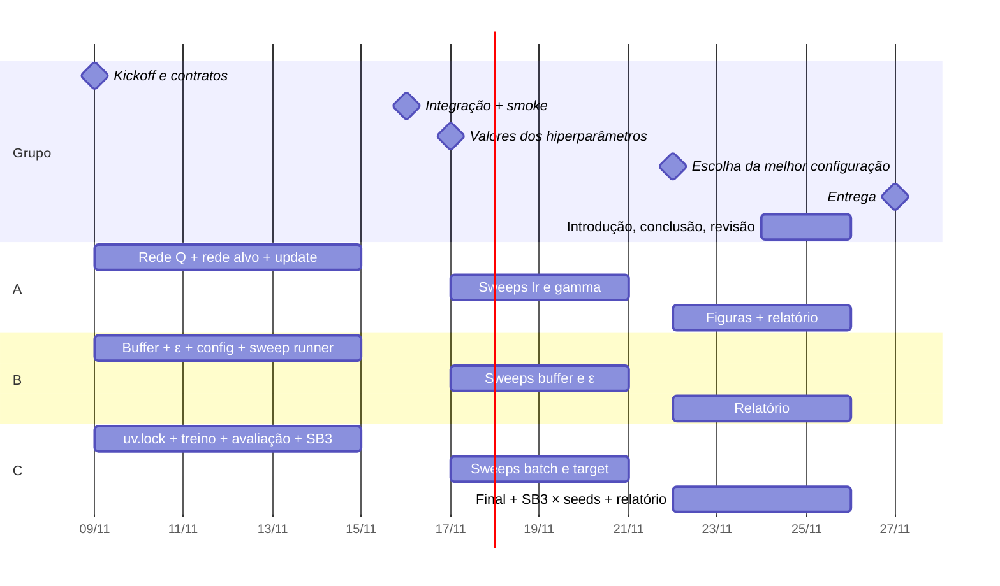

# Plano de implementação — DQN Lunar Lander

O DQN é dividido entre as três pessoas. Cada uma implementa **dois elementos essenciais do DQN**,
uma parte da infraestrutura, dois eixos da busca de hiperparâmetros e as seções do relatório sobre o
que fez. As frentes só se encontram em **contratos fixados no início**, então ninguém espera ninguém
até a integração em **16/11**. A entrega é em **27/11/2026**.

## 1. Decisões tomadas

- **Framework: PyTorch.** Fora de `network.py` e `agent.py`, nenhum arquivo importa `torch`. Todo
  o resto usa só NumPy e troca `np.ndarray`/`int` com o agente.
- **Relatório: Overleaf**, com o projeto sincronizado com `report/` no git.
- **Valores de hiperparâmetros:** ficam para depois da integração (seção 6).

## 2. Divisão

A spec (3.1) lista seis elementos essenciais do DQN. Cada pessoa fica com dois:

| | Pessoa A | Pessoa B | Pessoa C |
|---|---|---|---|
| **Núcleo DQN** | Rede Q; rede alvo + regra de atualização (TD, loss, otimizador) | Replay buffer; política ε-greedy com decaimento | Loop de treinamento; avaliação |
| **Arquivos do núcleo** | `network.py`, `agent.py` | `replay_buffer.py`, `exploration.py` | `train.py`, `evaluate.py` |
| **Infraestrutura** | `aggregate.py`, `make_figures.py` | `config.py`, `run_sweep.py` | `run_logger.py`, `run_sb3.py`, `uv.lock` |
| **Testes** | `test_agent.py` | `test_replay_buffer.py`, `test_exploration.py`, `test_config.py` | `test_evaluate.py`, `test_no_forbidden_imports.py` |
| **Sweeps** | `learning_rate`, `gamma` | `buffer_size`, `epsilon` | `batch_size`, `target_update` |
| **Relatório** | Implementação: rede e atualização; figuras | Implementação: buffer e exploração; metodologia da busca | Implementação: treino e avaliação; comparação com SB3 |

Os sweeps seguem o componente de cada um. Quem implementou o buffer analisa o tamanho do buffer, e
assim por diante. Introdução, conclusão e capa ficam para os três na semana final.

## 3. Contratos (aprovar no kickoff)

Uma mudança nestes contratos depois do kickoff precisa de aviso ao grupo.

**3.1 Replay buffer** (`replay_buffer.py`): B implementa, A usa.

```python
buf = ReplayBuffer(capacity: int, obs_dim: int, rng: np.random.Generator)
buf.add(obs, action: int, reward: float, next_obs, terminated: bool) -> None
buf.sample(batch_size: int) -> Batch   # campos: obs, actions, rewards, next_obs, dones (np.ndarray)
len(buf) -> int
```

**3.2 Exploração** (`exploration.py`): B implementa, A usa.

```python
LinearEpsilon(start: float, end: float, decay_steps: int)(step: int) -> float
epsilon_greedy(q_values: np.ndarray, epsilon: float, rng: np.random.Generator) -> int
```

**3.3 Agente** (`agent.py`): A implementa, C usa.

```python
agent = DQNAgent(obs_dim: int, n_actions: int, hp: Hyperparameters, rng: np.random.Generator)
agent.act(obs: np.ndarray, epsilon: float) -> int
agent.store(obs, action, reward, next_obs, terminated) -> None
agent.update() -> float        # 1 passo de gradiente; retorna a loss
agent.sync_target() -> None
agent.save(path) -> None
```

O loop de treino (C) decide quando chamar `update` e `sync_target`. O agente não conhece o
ambiente nem o passo global.

**3.4 Avaliação** (`evaluate.py`): C implementa, C usa para o DQN e para o SB3.

```python
evaluate(policy: Callable[[np.ndarray], int], cfg: EvalConfig, n_episodes: int) -> dict
# -> {mean_return, std_return, success_rate, mean_length, n_episodes}
```

**3.5 Configs** (`config.py`): B implementa, todos usam. As chaves de `hyperparameters.yaml`
e `evaluation.yaml` e o formato dos sweeps (`name`, `seeds`, `variants`) são os que já estão
no repositório. `RunConfig` expõe `run_id`, `config_id`, `hp` e `evaluation`.

**3.6 Saída de uma run** (`run_logger.py`): C escreve, A lê.

| Arquivo | Conteúdo |
|---|---|
| `config.json` | configuração completa + `run_id`, `config_id` |
| `meta.json` | hostname, commit git, versões, horário |
| `train.csv` | `step, episode, return, length, epsilon, loss` (1 linha por episódio) |
| `eval.csv` | `step, mean_return, std_return, success_rate, mean_length` (1 linha por avaliação) |
| `summary.json` | saída de `evaluate` na avaliação final + `wall_time_s`; marca a run como concluída |

```python
log = RunLogger(cfg: RunConfig, results_dir: Path)
log.log_episode(**linha_train)  ;  log.log_eval(**linha_eval)  ;  log.finish(final_eval) -> dict
is_complete(run_dir: Path) -> bool   # summary.json existe
```

**3.7 Treino de uma run** (`train.py`): C implementa, B chama no `run_sweep.py`.

```python
train(cfg: RunConfig, results_dir: Path) -> dict   # grava a run (3.6) e retorna o summary
```

As assinaturas exatas, com tipos e docstrings, estão em `src/dqn/`. As funções levantam
`NotImplementedError` até o dono implementar.

## 4. Como cada um trabalha sem esperar os outros

Cada pessoa usa um substituto descartável para o que ainda não recebeu.

| Pessoa | Depende de | Substituto até 16/11 | Pronto quando |
|---|---|---|---|
| A | buffer e ε (B), formato das runs (C) | Um buffer simples com lista Python e um gerador de runs falsas no formato 3.6 | Testes passam; `update` reduz a loss num batch fixo; figuras saem das runs falsas |
| B | agente (A), treino (C) | Nenhum: buffer, ε e config são testáveis sozinhos; o sweep usa uma função `train` que só grava o formato 3.6 | Testes passam; `run_sweep.py` expande variants × seeds, pula runs concluídas e roda com `--workers` |
| C | agente (A), config (B) | Um `RandomAgent` com a interface 3.3 e um `RunConfig` montado à mão | `train.py` roda de ponta a ponta com o `RandomAgent`; SB3 é avaliado pelo mesmo `evaluate` e gravado no formato 3.6 |

**Integração (16/11):** cada um troca o substituto pela peça real. O grupo roda o sweep `smoke`
nas três máquinas e verifica que o agente aprende antes de qualquer sweep longo.

**Ao rodar experimentos:** `git pull` → rodar o sweep → commitar `results/runs/` → `git push`.
Como o `run_id` é determinístico, a configuração de referência roda uma vez só e aparece em
todos os sweeps.

## 5. Cronograma



| Data | Marco | Critério |
|---|---|---|
| 09/11 | Kickoff | Contratos (seção 3) aprovados; quem é A, B e C; `uv.lock` no git; projeto no Overleaf |
| 15/11 | Fim da fase paralela | Cada pessoa com PR aprovado e testes passando |
| 16/11 | Integração | `smoke` roda nas 3 máquinas; o agente aprende |
| 17/11 | Valores | `hyperparameters.yaml`, `evaluation.yaml` e sweeps preenchidos |
| 21/11 | Fim da busca | Todos os sweeps concluídos e com push |
| 22/11 | Configuração final | Melhor combinação em `hyperparameters.yaml`; rodada `final` e SB3 iniciadas |
| 26/11 | Revisão | Relatório completo, README reproduz os resultados, `.zip` montado |
| 27/11 | Entrega | — |

## 6. A decidir

- [ ] Quem é A, B e C (kickoff).
- [ ] Valores de referência em `hyperparameters.yaml` e orçamento de passos (17/11, depois do `smoke`).
- [ ] Protocolo em `evaluation.yaml` (17/11).
- [ ] Valores de cada sweep e nº de seeds: cada dono propõe os dos seus (17/11).
